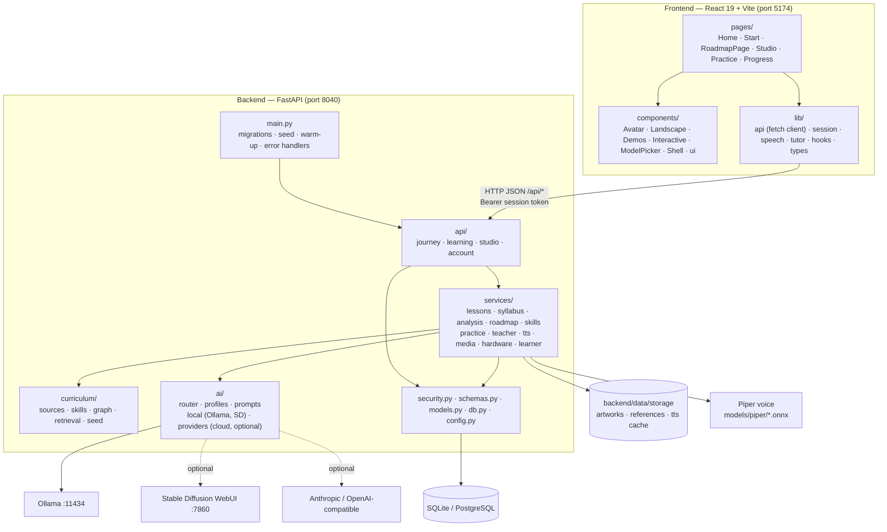
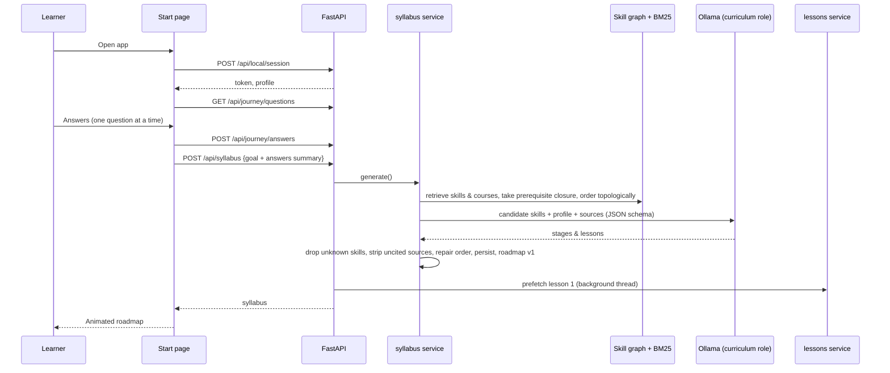
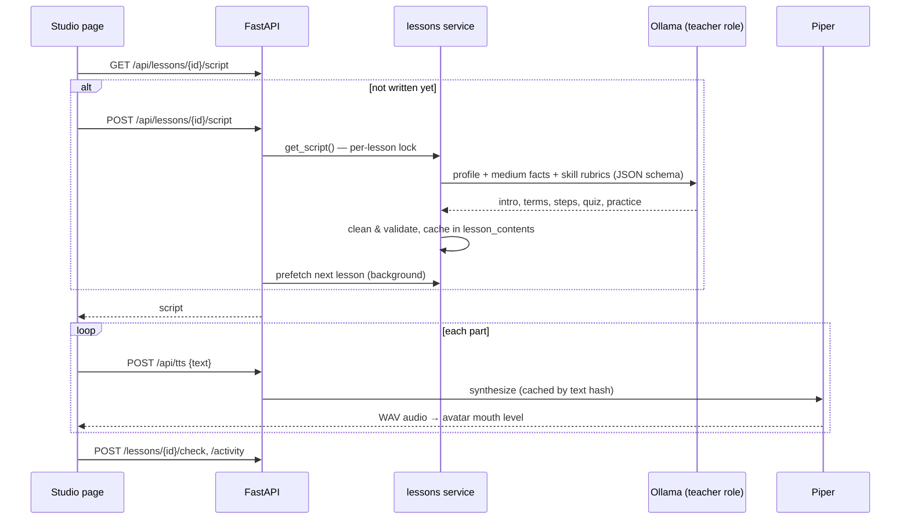
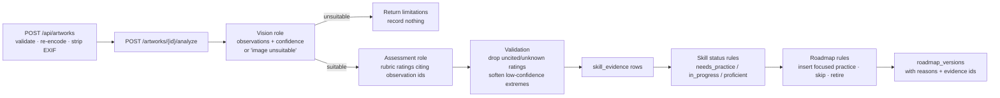
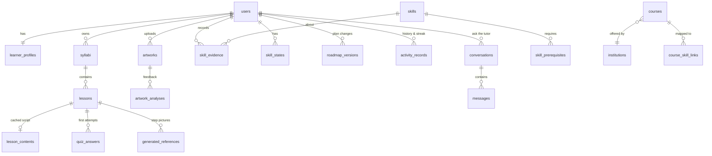

# System architecture

ArtOfSoul.N is a two-tier local web application: a **React single-page app** talks to a **FastAPI backend** over
HTTP/JSON. The backend owns all state (SQLite by default) and all AI calls, which go to local servers (Ollama, and
optionally Stable Diffusion WebUI). The browser never talks to an AI service directly and never holds an API key.

## Components

In development the Vite dev server proxies `/api` to `http://localhost:8040` (`frontend/vite.config.ts`), so the
browser only ever talks to one origin. In Docker, nginx does the same (`frontend/nginx.conf`).

## Request lifecycle

1. The frontend calls `api.get/post/...` (`frontend/src/lib/api.ts`), which adds `Authorization: Bearer <token>` from
   `localStorage`.
2. FastAPI validates the body with Pydantic (`schemas.py` or models declared in the router) — invalid input returns
   **422** with the field errors.
3. `security.current_user` decodes the JWT and loads the user; AI endpoints also pass a per-user sliding-window
   **rate limit** (`RATE_LIMIT_AI_PER_MINUTE`).
4. A service performs the work inside a SQLAlchemy session. AI calls go through `ModelRouter`, which maps a role to
   `provider:model`, calls the provider, and logs usage on a background thread.
5. Errors become JSON: `AIError` subclasses → **503** (not configured, e.g. Ollama not running) or **502** (provider
   failed); any unexpected exception → **500** with a friendly message, full traceback in the terminal.

## Key flows

### Onboarding to plan

### A lesson

### Practice feedback and adaptation

**Skill status rules** (`services/skills.py`, last three pieces of evidence):

- 2+ "needs work" → **needs practice** (unless the latest is "solid", which means improving → in progress)
- 2+ "solid" including artwork evidence, latest not "needs work" → **proficient**
- self-placement alone can only reach **in progress**

**Roadmap rules** (`services/roadmap.py`):

- R1 — an upcoming lesson depends on a skill that needs practice → insert a focused-practice lesson before it (once)
- R2 — every skill of an upcoming, non-milestone lesson is proficient → mark it skipped (restorable)
- R3 — a pending focused-practice lesson whose skill is now proficient → skip it

## AI layer

| Role | Used for | Default |
|---|---|---|
| `teacher` | Lesson scripts, answering questions | `ollama:gemma4:e4b` |
| `curriculum` | Personalised syllabus | `ollama:gemma4:e4b` |
| `vision` | Observing uploaded artwork | `ollama:gemma4:e4b` |
| `assessment` | Rubric ratings from observations | `ollama:gemma4:e4b` |
| `coordinator` | Routing free-text requests; memory notes | `ollama:gemma4:e4b` |
| `exercise` | Exercises and palettes (first-version endpoints) | `ollama:gemma4:e4b` |
| `image` | Step pictures / references | `none:` (off) |

`ModelRouter.spec(role)` resolves the model in this order: the learner's saved **AI quality** choice
(`backend/data/model_choice.json`) → the `MODEL_<ROLE>` environment variable.

Providers (`ai/local.py`, `ai/providers.py`):

- **OllamaProvider** — `/api/chat` with `format` (JSON schema), `think: false`, `num_ctx`, `keep_alive`; images passed
  as base64; one retry on invalid JSON; clear errors for "not running", "model not downloaded", out-of-memory and
  dropped connections; `pull()` streams download progress; `warm_up()` preloads the model.
- **SDWebUIProvider** — `/sdapi/v1/txt2img`.
- **NoImageProvider** — explains that image generation is off.
- **AnthropicProvider / OpenAIProvider** — optional; `OPENAI_BASE_URL` allows any OpenAI-compatible server.

## Data model

27 tables, created by Alembic migrations `0001`–`0003`. The ones the current journey relies on:

Other tables: `curriculum_versions`, `curriculum_modules`, `learning_objectives`, `exercise_templates`,
`assessment_rubrics`, `exercises`, `ai_usage`.

Files: uploads are re-encoded to JPEG and stored under `backend/data/storage/artworks/<user>/`; generated images under
`references/`; synthesized speech under `tts/`. Images are served only through HMAC-signed, expiring URLs
(`/api/media/...`).

## Startup sequence (`app/main.py`)

1. Run Alembic migrations to `head`.
2. Seed the curriculum knowledge base (idempotent, versioned `2026.10`).
3. Start a background thread that loads the teacher model into Ollama's memory.
4. Serve requests.
